# TRACKNET / NSIS
## National Sports Intelligence System & Athlete Retention Agent

[](https://www.python.org/)
[](https://fastapi.tiangolo.com/)
[](https://react.dev/)
[](https://www.typescriptlang.org/)
[](https://vitejs.dev/)
[](https://tailwindcss.com/)
[](#)

> **TrackNet (NSIS)** is an intelligence and policy-execution operating layer for Indian Sports (Ministry of Youth Affairs and Sports / Khelo India ecosystem). It provides continuous visibility into the athlete pipeline across identification, support, and progression, bridging the critical gap between grassroots talent identification (KID) and long-term sports retention.

---

## 🏛 Core Purpose & Operating Loop

The system operates on an auditable policy-execution cycle:

$$\text{Sense} \longrightarrow \text{Diagnose} \longrightarrow \text{Prescribe} \longrightarrow \text{Allocate} \longrightarrow \text{Measure}$$

- **Sense**: Verified registry of athletes, trainers, institutions, and facilities with strict minor consent & DPDP protections.
- **Diagnose**: District × Sport × Age-band gap diagnosis with small-cell privacy suppression ($< 5$ counts suppressed).
- **Prescribe**: Explainable policy levers mapped to versioned scheme rules with clause-level citations.
- **Allocate**: Eligibility matching, equipment loans, and opportunity listings—with strict human-in-the-loop approvals.
- **Measure**: Multi-year pipeline conversion, dropout curves, and scheme uptake metrics.

---

## 🔒 Non-Negotiable System Invariants

1. **Decision Support, NOT Automated Selection**: NSIS never autonomously selects athletes, awards quotas, or disburses money. Officials approve every mutation.
2. **Protection of Minors by Design**:
   - Mandatory guardian consent step prior to submission.
   - Unauthorized attempts to view minor profiles return **HTTP 404 Not Found** (never 403) to prevent existence probing.
   - Immutable audit logging on every read or query touching a minor record.
3. **Field-Level Encryption**: All sensitive identifying data (DOB, contact details, guardian references) is encrypted at rest.
4. **No Biometrics / Aadhaar**: Never collect Aadhaar numbers, biometric data, or identity document scans.
5. **Read-Mostly Agent with ActionProposal Gating**: The AI agent assists by querying approved documents and proposing actions (`approver_id != actor_id`).

---

## 🏗 Architecture Overview

```mermaid
flowchart TB
    subgraph UI ["Frontend (React 18 + TypeScript + TailwindCSS)"]
        Landing["Public Landing & Verification Status"]
        Dashboard["Pipeline Diagnosis & Retention Heatmaps"]
        Registry["Unified Registry (Athletes, Coaches, Facilities)"]
        SchemesUI["Scheme Rules & Eligibility Checker"]
        AgentUI["Agent Assistant & Policy RAG Console"]
        ApprovalsUI["Human Action Proposals Inbox"]
    end

    subgraph API ["FastAPI Core Backend (Python 3.11+)"]
        AuthRouter["/api/v1/auth (RBAC + Geo-Scope)"]
        RegistryRouter["/api/v1/registry"]
        PipelineRouter["/api/v1/pipeline (Aggregates & Gaps)"]
        SchemesRouter["/api/v1/schemes (Eligibility Engine)"]
        AgentRouter["/api/v1/agent (Tool Calls & RAG)"]
        AuditRouter["/api/v1/audit (Immutable Event Trail)"]
    end

    subgraph CoreEngine ["Domain Engines & Workflow Logic"]
        DedupEngine["Fuzzy Trigram Deduplication"]
        StateMachines["Verification & Approval State Machines"]
        EligibilityEngine["Deterministic Scheme Rule Evaluator"]
        GapAnalyzer["Peer Median Pipeline Gap Analyzer"]
        OutboxRelay["Idempotent Outbox Notification Worker"]
    end

    subgraph Persistence ["Data Layer (PostgreSQL / SQLite)"]
        DB[(Core Database + PostGIS)]
        VectorIndex[(pgvector / Approved Policy Chunks)]
        AuditLog[(Tamper-Resistant Audit Trail)]
    end

    UI --> API
    API --> CoreEngine
    CoreEngine --> Persistence
```



---

## 📂 Repository Layout

```text
sports-network-agent/
├── CLAUDE.md                    # Core ground rules & invariants (auto-loaded)
├── DECISIONS.md                 # Architecture Decision Records (ADRs)
├── PROGRESS.md                  # Milestone status & phase gate tracker
├── README.md                    # System pitch, architecture, and run instructions
├── PLANS.md                     # Ministry concept note & policy alignment
├── IDEAS.md                     # Implementation blueprint & acceptance criteria
│
├── docs/                        # Specifications & Compliance
│   ├── ASSUMPTIONS.md           # Operational assumptions & default values
│   ├── KNOWN_GAPS.md            # Deferred capabilities & gap tracker
│   ├── 01-constraints.md        # Hard security, privacy & legal constraints
│   ├── 02-data-model.md         # Data models, entities & encryption policies
│   ├── 03-screens.md            # UI design specifications
│   └── 04-phases.md             # AI SDLC phase definitions & gates
│
├── backend/                     # Python 3.11+ FastAPI Backend
│   ├── requirements.txt         # Core dependencies
│   ├── app/
│   │   ├── main.py              # Application entrypoint & middleware
│   │   ├── core/                # Config, DB connection, crypto & RBAC
│   │   ├── models/              # SQLAlchemy 2.0 ORM models
│   │   ├── schemas/             # Pydantic v2 schemas
│   │   ├── services/            # Domain logic (Registry, Pipeline, Schemes, Agent)
│   │   └── api/routes/          # REST API endpoints
│   └── tests/                   # Pytest test suite
│
└── frontend/                    # React 18 + Vite + TypeScript Frontend
    ├── package.json             # Node dependencies
    ├── vite.config.ts           # Vite bundler configuration
    ├── tailwind.config.js       # Tailwind CSS configuration
    └── src/
        ├── main.tsx             # React entrypoint
        ├── App.tsx              # Router & layout
        ├── components/          # Reusable UI components
        ├── pages/               # Views (Landing, Diagnosis, Registry, Agent, Approvals)
        └── services/            # API client & mock data fallback
```

---

## 👥 Seed Roles & Access Scopes

| Role | Typical Actor | Geographical Scope | Permissions |
| :--- | :--- | :--- | :--- |
| `NATIONAL_ADMIN` | Ministry / SAI Directorate | All States & Districts | Full policy view, scheme rule approvals, agent config |
| `STATE_OFFICER` | State Directorate Officer | Assigned State | State gap view, district comparisons, state scheme authoring |
| `DISTRICT_OFFICER` | District Sports Officer (DSO) | Assigned District | Registry verification, equipment loans, athlete support |
| `COACH` | Certified Coach / Trainer | Assigned Athletes / Club | Athlete onboarding, journey updates, training logs |

---

## 🚀 Local Quickstart

### Prerequisites
- Python 3.11 or higher
- Node.js 18 or 20
- PostgreSQL with PostGIS (optional for dev; SQLite fallback supported)

### Backend Setup
```bash
cd backend
python3 -m venv venv
source venv/bin/activate
pip install -r requirements.txt
cp ../.env.example .env

# Initialize DB & Seed Data
python -c "from app.core.db import init_db; init_db()"

# Start FastAPI Server
PYTHONPATH=. uvicorn app.main:app --host 0.0.0.0 --port 8000 --reload
```
API Documentation will be live at: `http://localhost:8000/docs`

### Frontend Setup
```bash
cd frontend
npm install
npm run dev
```
Open `http://localhost:5173` in your browser.

---

## 🧪 Testing & Verification

Run backend unit & security tests:
```bash
cd backend
pytest tests/ -v
```

Run frontend lint & build checks:
```bash
cd frontend
npm run build
```
